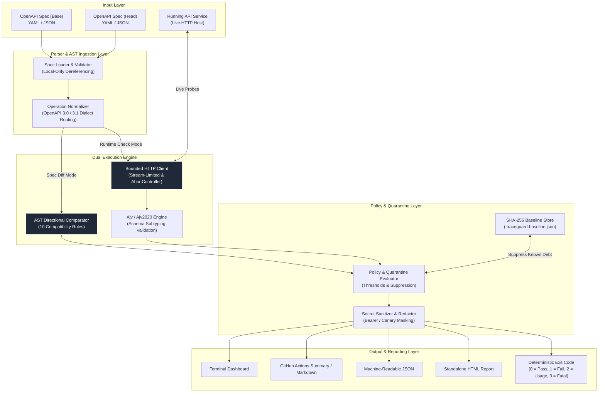
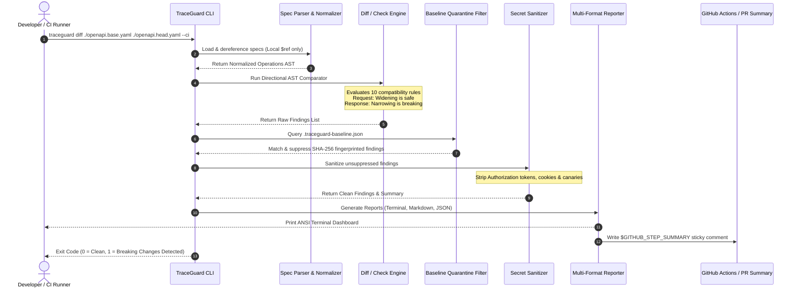
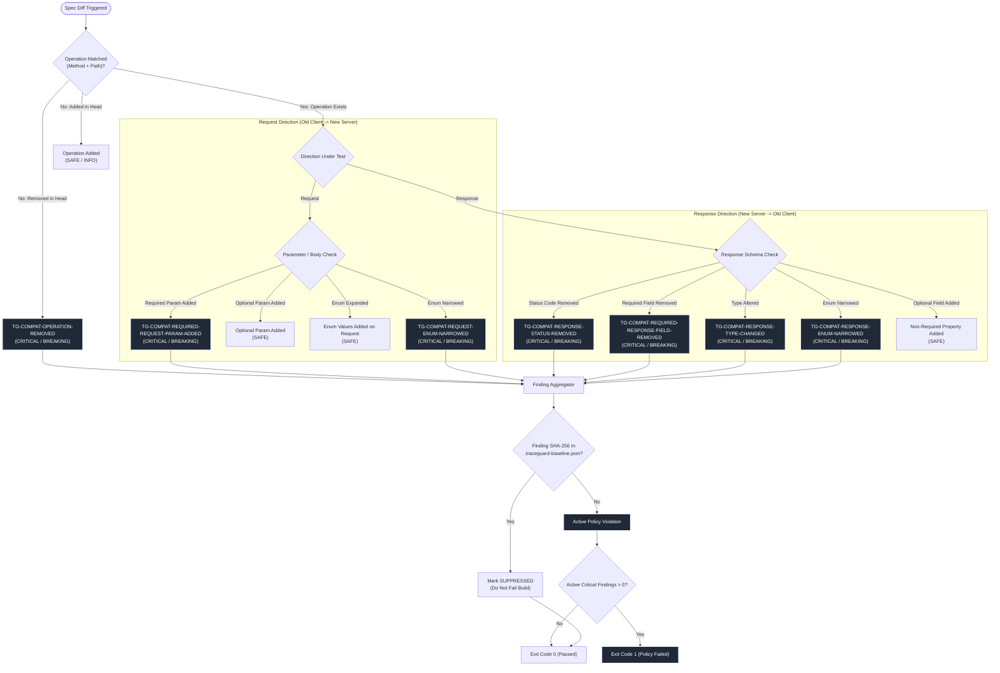
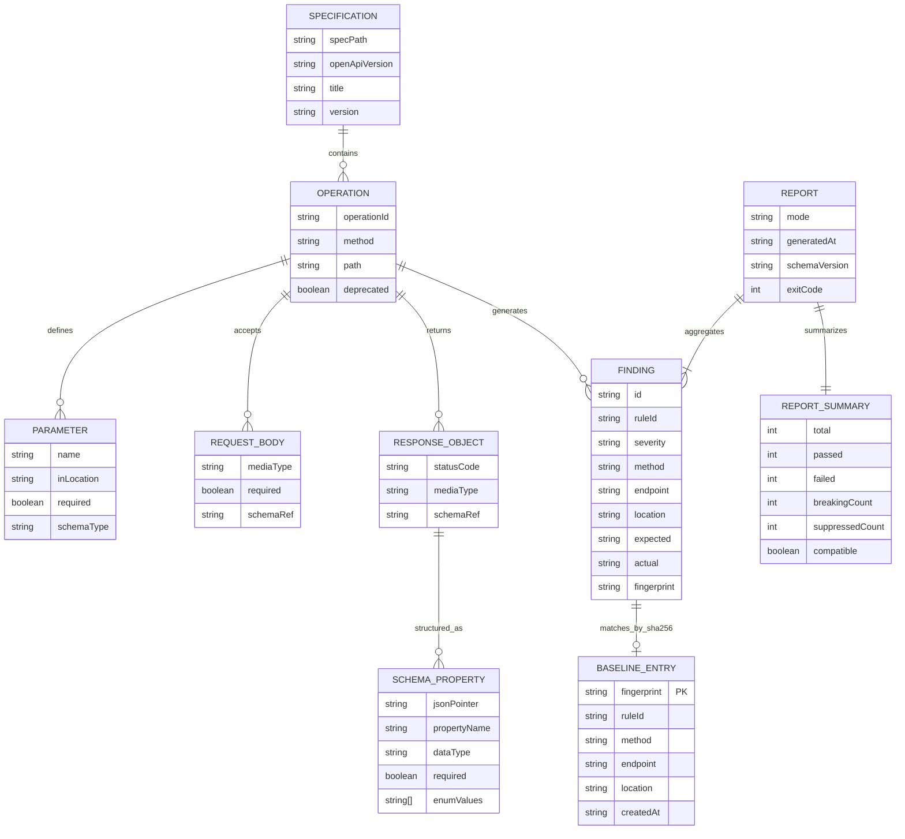
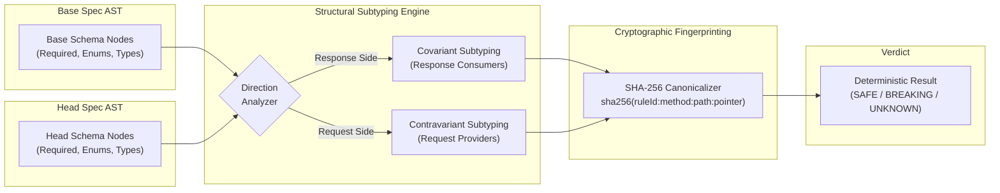

<p align="center">
  
</p>

# TraceGuard

> **Catch breaking API changes before they reach production.**

[](https://www.npmjs.com/package/@arnavvv/traceguard)
[](LICENSE)
[](https://nodejs.org/)
[](https://www.typescriptlang.org/)
[](https://github.com/arnnnnaaavvvvv/TraceGuard)
[](SECURITY.md)

---

## Overview

**TraceGuard** is a deterministic, zero-dependency contract testing CLI and TypeScript SDK engineered to detect breaking API changes, validate live service payloads against OpenAPI 3.0.x and 3.1.x specifications, and enforce backward compatibility in CI/CD pipelines. Built for platform engineers, backend teams, and SDK maintainers who operate in high-concurrency, zero-trust environments, TraceGuard runs 100% locally and deterministically. It requires no SaaS subscriptions, cloud accounts, AI heuristics, or background telemetry. Whether deployed as an ephemeral pull-request gate, imported as a typed test helper in Vitest/Jest, or executed as an interactive terminal dashboard, TraceGuard halts contract regressions before they disrupt downstream consumers.

---

## Feature Matrix

| Feature | Description |
| :--- | :--- |
| **Directional AST Compatibility Diff** | Distinguishes client-send (request) from client-consume (response) semantics across 10 formal backward-compatibility rules. Correctly permits optional parameter expansion while blocking response enum narrowing. |
| **Live Runtime Contract Checker** | Dispatches live, bounded HTTP probes against running microservices. Validates observed status codes, response headers, and streaming JSON bodies against OpenAPI schemas using dual Ajv engines. |
| **SHA-256 Baseline Quarantine** | Fingerprints pre-existing legacy contract drift into an audited `.traceguard-baseline.json` file. Suppresses historical technical debt so only newly introduced regressions break active pull requests. |
| **Dual OpenAPI Dialect Support** | Transparently normalizes and routes validation between OpenAPI 3.0.x (with nullable transformations) and OpenAPI 3.1.x (JSON Schema Draft 2020-12 via `Ajv2020`). |
| **Multi-Format Enterprise Reporting** | Generates high-contrast ANSI terminal output, GitHub Flavored Markdown for PR summaries (`$GITHUB_STEP_SUMMARY`), machine-readable JSON for telemetry pipelines, and standalone visual HTML reports. |
| **Hostile-Input Hardened Architecture** | Enforces strict local-only `$ref` dereferencing (immune to SSRF and remote path traversal), ReDoS regex execution timeouts, streaming body size limits (10MB abort switch), and prototype-pollution blocks. |
| **Universal Package Manager Support** | First-class global CLI and local project installation across `npm`, `pnpm`, `yarn`, and `bun`, alongside zero-install execution via `npx` and `pnpm dlx`. |
| **Interactive Visual Dashboard** | Ships with `traceguard serve`, an embedded zero-dependency local web dashboard featuring a live interactive API playground, terminal simulator, and architectural inspection tools. |

---

## What It Can Do Now

- **Detects Breaking Spec Changes:** Analyzes differences between git branches or local files (`traceguard diff base.yaml head.yaml`) and isolates breaking schema alterations.
- **Validates Running Services:** Executes HTTP probes against live servers (`traceguard check --spec openapi.yaml --base-url http://localhost:8080`) and asserts payload conformity.
- **Quarantines Historical Tech Debt:** Generates immutable SHA-256 baseline snapshots (`traceguard baseline save`) to ensure green builds on legacy codebases without ignoring new bugs.
- **Enforces Pull Request Gates:** Exits with deterministic status codes (`0` clean, `1` violation, `2` syntax error, `3` fatal crash) for GitHub Actions and GitLab CI integration.
- **Redacts Sensitive Credentials:** Automatically masks Bearer tokens, passwords, query credentials, and canary strings across all CLI, Markdown, and JSON outputs.
- **Integrates into TypeScript Test Suites:** Exports promise-based SDK helpers (`createTraceGuard()`, `compareContracts()`) with complete TypeScript declarations.

---

## The Problem

Modern microservice architectures frequently suffer from silent schema drift: backend teams rename an attribute, narrow an enum, or make an optional parameter required, instantly breaking mobile clients, frontend single-page apps, and third-party consumers.

| Dimension | Manual Code Review | Schema Linters (Spectral) | Contract Frameworks (Pact) | TraceGuard |
| :--- | :--- | :--- | :--- | :--- |
| **Breaking Change Precision** | Low (Human oversight) | Medium (Style, not consumer drift) | High (Consumer-driven) | **High (Direction-aware AST diff)** |
| **Runtime Verification** | None | None (Static syntax only) | High (Requires dedicated mock broker) | **High (Direct bounded HTTP probes)** |
| **Directional Semantics** | Inconsistent | None | High | **Yes (Request vs. Response rules)** |
| **Infrastructure Overhead** | None | Low | High (Broker server, database) | **Zero (Single CLI / SDK binary)** |
| **Historical Debt Handling** | Manual tracking | Comment disables (`# noqa`) | Separate state tags | **Cryptographic SHA-256 Baseline** |
| **Telemetry & Privacy** | N/A | Often transmits telemetry | Varies by vendor | **100% Offline (Zero network calls)** |
| **Setup Time** | N/A | ~15 minutes | Days to weeks | **< 60 seconds** |

---

## Get Started

### 1. Global CLI (System-Wide Availability)

Install globally to execute contract tests, generate diffs, or serve the visual dashboard from any repository:

```bash
# npm
npm install -g @arnavvv/traceguard

# pnpm
pnpm add -g @arnavvv/traceguard

# yarn
yarn global add @arnavvv/traceguard

# bun
bun add -g @arnavvv/traceguard
```

### 2. Zero-Install via npx (Recommended for CI & Ephemeral Runs)

Run instantly without persisting files to disk:

```bash
npx @arnavvv/traceguard diff ./spec.v1.yaml ./spec.v2.yaml
```

### 3. Project DevDependency (Locked Team Versioning)

Save to `package.json` for reproducible builds across your engineering team:

```bash
npm install --save-dev @arnavvv/traceguard
```

Add convenience scripts to `package.json`:

```json
{
  "scripts": {
    "test:contract": "traceguard check --spec ./openapi.yaml --base-url http://localhost:8080 --ci",
    "contract:diff": "traceguard diff ./openapi.base.yaml ./openapi.head.yaml --ci"
  }
}
```

---

## Docker Quick Start

Run TraceGuard in an isolated container without local Node.js installed:

```bash
docker run --rm \
  -v $(pwd):/workspace \
  -w /workspace \
  node:22-alpine \
  npx @arnavvv/traceguard diff ./openapi.v1.yaml ./openapi.v2.yaml --ci
```

---

## Example Input → Output

### Input Specifications

**Base Specification (`spec-v1.yaml`):**
```yaml
openapi: 3.1.0
info:
  title: User Service
  version: 1.0.0
paths:
  /api/users/{id}:
    get:
      responses:
        '200':
          content:
            application/json:
              schema:
                type: object
                required: [id, name, email]
                properties:
                  id: { type: string }
                  name: { type: string }
                  email: { type: string }
```

**Modified Specification (`spec-v2.yaml`):**
```yaml
openapi: 3.1.0
info:
  title: User Service
  version: 2.0.0
paths:
  /api/users/{id}:
    get:
      responses:
        '200':
          content:
            application/json:
              schema:
                type: object
                required: [id, name]
                properties:
                  id: { type: integer } # Changed from string to integer
                  name: { type: string }
                  # 'email' property was removed
```

### Execution

```bash
traceguard diff ./spec-v1.yaml ./spec-v2.yaml --format terminal
```

### Output

```text
================================================================================
 TRACEGUARD CONTRACT REPORT - MODE: DIFF
 Schema Version: 1.0.0 | Engine: v0.1.0
================================================================================

 [FAIL] FINDINGS (2 total):
--------------------------------------------------------------------------------
 #1 [CRITICAL] [BREAKING] TG-COMPAT-RESPONSE-TYPE-CHANGED
    Target:     GET /api/users/{id}
    Location:   #/paths/~1api~1users~1{id}/get/responses/200/content/application~1json/schema/properties/id/type
    Expected:   Type 'string'
    Actual:     Type 'integer'
    Message:    Response schema type changed from 'string' to 'integer'.
--------------------------------------------------------------------------------
 #2 [CRITICAL] [BREAKING] TG-COMPAT-REQUIRED-RESPONSE-FIELD-REMOVED
    Target:     GET /api/users/{id}
    Location:   #/paths/~1api~1users~1{id}/get/responses/200/content/application~1json/schema/required
    Expected:   Property 'email' required
    Actual:     Property 'email' removed or optional
    Message:    Required response property 'email' was removed in 'GET /api/users/{id}'.
--------------------------------------------------------------------------------
 STATUS: [FAIL] CI Policy Threshold Violations:
   * Detected 2 breaking change(s) or critical contract mismatch(es).
   * Critical findings (2) exceeded threshold of 0.
================================================================================
```

---

## Usage Examples

### 1. Spec Diffing (Pull Request Compatibility Gate)

```bash
traceguard diff ./openapi.base.yaml ./openapi.head.yaml \
  --ci \
  --format markdown \
  --output ./breaking-changes.md
```

### 2. Runtime Contract Checking (Live Service Verification)

```bash
traceguard check \
  --spec ./openapi.yaml \
  --base-url http://localhost:8080 \
  --header "Authorization: Bearer test-token" \
  --timeout 5000 \
  --ci
```

### 3. Baseline Quarantine Workflow

```bash
# 1. Snapshot existing contract discrepancies into quarantine:
traceguard baseline save .traceguard-baseline.json --diff ./openapi.head.yaml

# 2. Run future diffs against the baseline (historical debt is suppressed):
traceguard diff ./openapi.base.yaml ./openapi.head.yaml --baseline .traceguard-baseline.json --ci
```

### 4. Interactive Local Visual Dashboard

```bash
traceguard serve --port 3000 --spec ./openapi.yaml
```

### 5. Programmatic TypeScript SDK Usage

```typescript
import { createTraceGuard, compareContracts } from '@arnavvv/traceguard';

// 1. Programmatically detect breaking contract changes:
const diffReport = await compareContracts({
  baseSpecPath: './specs/v1.yaml',
  headSpecPath: './specs/v2.yaml',
});

if (!diffReport.compatible) {
  console.error(`Blocked: ${diffReport.breakingCount} breaking changes detected.`);
  process.exit(1);
}

// 2. Programmatically validate a running microservice:
const client = createTraceGuard({
  spec: './specs/openapi.yaml',
  baseUrl: 'http://localhost:8080',
  headers: { 'X-API-Key': 'secret-token' },
  timeoutMs: 5000,
});

const checkReport = await client.check();
console.log(`Passed ${checkReport.summary.passed}/${checkReport.summary.total} operations.`);
```

---

## Configuration Reference

TraceGuard supports declarative configuration via `traceguard.config.ts`, `traceguard.config.json`, or CLI flags:

```typescript
// traceguard.config.ts
import { defineConfig } from '@arnavvv/traceguard';

export default defineConfig({
  spec: './specs/openapi.yaml',
  baseUrl: 'http://localhost:8080',
  mode: 'check',
  policy: {
    maxCritical: 0,
    maxWarn: 5,
    failOnBreaking: true,
  },
  client: {
    timeoutMs: 5000,
    maxBodySizeBytes: 10 * 1024 * 1024, // 10MB streaming limit
  },
  reporting: {
    format: 'terminal',
    redactSecrets: true,
  },
});
```

| Flag / Config Property | Environment Variable | Default | Description |
| :--- | :--- | :--- | :--- |
| `--spec <path>` | `TG_SPEC` | `undefined` | Path to the target OpenAPI YAML/JSON specification file. |
| `--base-url <url>` | `TG_BASE_URL` | `undefined` | Target HTTP server root for runtime contract validation. |
| `--baseline <path>` | `TG_BASELINE` | `undefined` | Path to `.traceguard-baseline.json` quarantine file. |
| `--ci` | `CI` | `false` | Enables CI enforcement mode; exits with code `1` on violations. |
| `--format <type>` | `TG_FORMAT` | `terminal` | Output format: `terminal`, `markdown`, `json`, or `html`. |
| `--output <path>` | `TG_OUTPUT` | `stdout` | Destination file path for generated contract reports. |
| `--timeout <ms>` | `TG_TIMEOUT` | `5000` | Per-request timeout in milliseconds before triggering abort. |
| `--max-body-bytes <n>` | `TG_MAX_BODY_BYTES` | `10485760` | Maximum allowable response body size in bytes (10MB default). |
| `--force` | `TG_FORCE` | `false` | Required flag to overwrite an existing baseline snapshot. |
| `--port <number>` | `PORT` | `3000` | Port for the interactive local visual server (`traceguard serve`). |

---

## System Architecture

The following diagram illustrates the forward data flow through TraceGuard's isolated layers:

*Figure 1: Request and data lifecycle across TraceGuard's isolated subsystems.*



---

## Core Workflow Sequence

The following sequence illustrates a pull request contract audit in an automated CI/CD pipeline:

*Figure 2: End-to-end execution sequence of a CI/CD pull request contract check.*



---

## Compatibility Decision Logic

The following logic flow dictates how changes are evaluated for backward compatibility:

*Figure 3: Decision tree for directional backward compatibility and baseline suppression.*



---

## Entity Relationship Model

The following diagram defines the core data model and relationships managed throughout TraceGuard's execution lifecycle:

*Figure 4: Entity relationships between specifications, operations, findings, and reports.*



---

## Core Algorithm & Logic Explanation

TraceGuard enforces backward compatibility using **Directional Structural Subtyping** combined with **Cryptographic Finding Fingerprinting**.

### 1. Direction-Aware Subtyping

In distributed HTTP architectures, compatibility is asymmetric:

- **Contravariant Request Side:** When a client sends a request to a server, the server may accept a broader set of inputs without breaking existing callers. Adding an optional parameter or expanding an accepted enum is safe. Conversely, adding a required parameter or narrowing an enum shrinks acceptable caller inputs and is **breaking**.
- **Covariant Response Side:** When a client consumes a response from a server, the client expects the server to fulfill all previous contractual promises. Adding a non-required property is safe. Conversely, removing a property, changing an attribute's type, or narrowing an enum eliminates values the client may depend upon and is **breaking**.

*Figure 5: Direction-aware structural subtyping and fingerprinting pipeline.*



### 2. SHA-256 Quarantine Fingerprinting

Findings are canonicalized into stable, location-independent cryptographic hashes:

$$\text{Fingerprint} = \text{SHA-256}(\text{ruleId} \mathbin{\Vert} \text{method} \mathbin{\Vert} \text{endpoint} \mathbin{\Vert} \text{jsonPointer})$$

Because fingerprints are derived strictly from AST coordinates rather than variable error messages or transient timestamps, legacy violations remain suppressed across refactors without risk of suppressing newly introduced regressions.

---

## Error Handling & Exit Codes

TraceGuard conforms to standard Unix process exit conventions:

| Exit Code | Classification | Meaning | Remediation |
| :--- | :--- | :--- | :--- |
| `0` | **Success** | All checks passed, or all detected findings were suppressed by baseline snapshot. | Proceed with deployment. |
| `1` | **Policy Failure** | Contract violations or breaking changes detected exceeding configured policy threshold. | Revert breaking changes or update consumer baseline using `--force`. |
| `2` | **Usage Error** | Invalid CLI invocation (e.g., missing required flags, mutually exclusive options). | Check `traceguard --help` for valid argument syntax. |
| `3` | **Fatal Error** | Unrecoverable runtime failure (e.g., connection refused, network timeout, unparsable spec syntax). | Ensure target server is accessible and OpenAPI specification is valid YAML/JSON. |

---

## Testing & Quality Assurance

TraceGuard maintains a strict 100% automated test pass rate across 108 test suites, including ReDoS security resistance, Slowloris streaming timeout guards, prototype pollution defense, and snapshot stability:

```bash
# Run all tests with Vitest
npm test

# Run test suite with V8 code coverage
npm run test:coverage

# Run TypeScript typechecker
npm run typecheck

# Run linter
npm run lint

# Perform dry-run package bundling
npm pack --dry-run
```

---

## Design Philosophy

1. **Determinism Over Heuristics:** Zero AI, zero stochastic matching, and zero cloud accounts. Given the same inputs, TraceGuard produces identical results across every developer workstation and CI runner.
2. **Directional Correctness:** API compatibility is asymmetric. Contract checkers that treat requests and responses identically generate harmful false positives and false negatives. TraceGuard strictly respects consumer vs. producer orientation.
3. **Zero-Trust Hostile Input Defense:** Specs, target payloads, and baselines are treated as untrusted data. Memory is capped, execution timers are enforced, external `$ref` URLs are blocked, and canary secrets are sanitized.
4. **Frictionless Developer Ergonomics:** Single-command execution with zero config required out of the box, offering first-class support for every major package manager (`npm`, `pnpm`, `yarn`, `bun`).

---

## Roadmap

- [x] OpenAPI 3.0.x and 3.1.x Dual-Dialect Support
- [x] Direction-Aware Breaking Change Detection Engine
- [x] Bounded Live HTTP Runtime Contract Checker
- [x] SHA-256 Baseline Quarantine Snapshotting
- [x] Zero-Dependency Visual Web Dashboard (`traceguard serve`)
- [x] Multi-Package Manager Distribution (`npm`, `pnpm`, `yarn`, `bun`, `npx`)
- [ ] Automated GitHub App with Sticky PR Comment Bot
- [ ] AsyncAPI 2.x / 3.x Event-Driven Contract Validation
- [ ] gRPC / Protocol Buffers Backward Compatibility Comparator
- [ ] OpenTelemetry Trace-Correlated Contract Verification

---

## Author & Community

- **Creator & Maintainer:** [Arnav](https://github.com/arnnnnaaavvvvv)
- **Package Distribution:** [`@arnavvv/traceguard` on npm](https://www.npmjs.com/package/@arnavvv/traceguard)
- **Security Inquiries:** See [SECURITY.md](SECURITY.md) for vulnerability disclosure guidelines.

---

## License

TraceGuard is open-source software licensed under the [MIT License](LICENSE).
